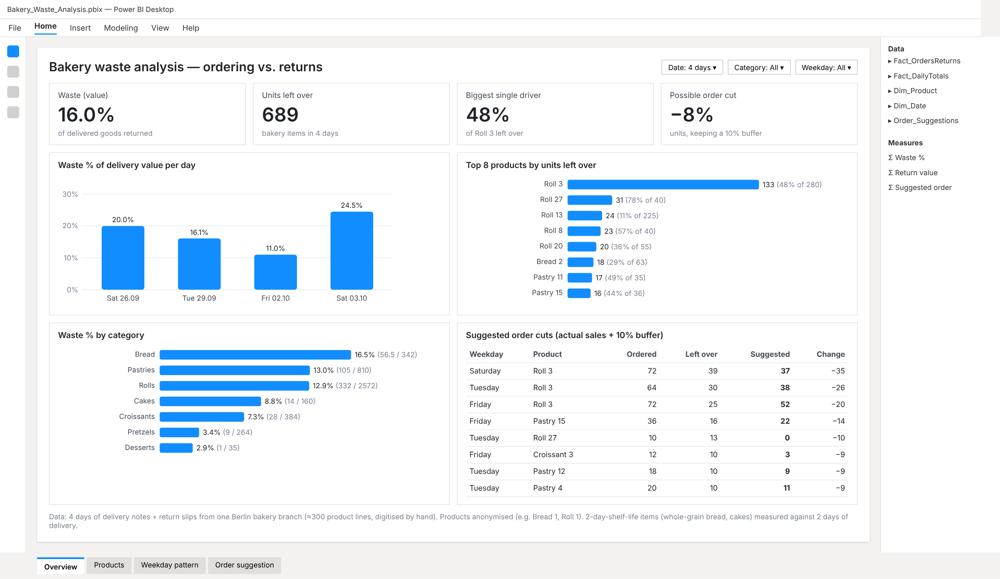
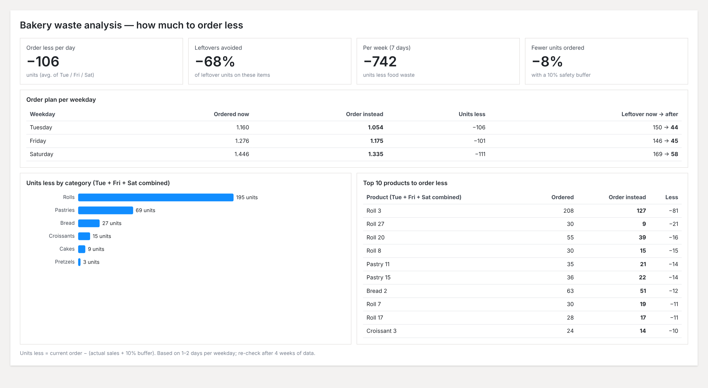

1) Yes, the repo is rutuldalsaniya/bakery-waste-dashboard.
2) README text is below.
3) Yes, commit to the default branch (main).

README.md:

# Bakery Waste Analysis: Ordering vs. Returns

A self-initiated analytics project from my job at a Berlin bakery branch. I digitised paper delivery notes and return slips, modelled orders against leftovers, and built Power BI and Looker Studio dashboards that show how much less to order per product and weekday.

**Result:** management adopted the recommendations, and daily wastage dropped by about **€300 per day**.

## The problem

Every day the branch ordered bread, rolls and pastries by gut feeling. Unsold goods went back as returns (*Retoure*), and nobody had a clear view of which products were over-ordered, on which days, or by how much.

## What I did

1. **Data collection:** digitised 4 days of delivery notes and return slips (~300 product lines) into structured CSV files, using AI-assisted transcription and manual checks.
2. **Data modelling:** joined orders with leftovers per product and day, then estimated sales (`sold = available − leftover`).
3. **Shelf-life logic:** whole-grain breads and cakes stay on sale for 2 days, so their available stock = today's order + yesterday's order. Everything else is a 1-day item.
4. **Order suggestion:** `suggested order = average actual sales + 10% safety buffer`, per product and weekday.
5. **Dashboards:** built a star-schema model in Power BI (fact tables for orders/returns and daily totals; dimensions for product and date) with DAX measures, plus a Looker Studio version.

## Key findings (4-day sample)

| Metric | Value |
|---|---|
| Waste as % of delivery value | **16%** |
| Units left over | **689** |
| Biggest single driver | One roll type with **48%** left over |
| Possible order reduction | **−8%** of units, keeping a 10% buffer |
| Leftovers avoided on affected items | **−68%** |

## Files

| File | What it holds |
|---|---|
| `bakery_orders_vs_returns.csv` | Main fact table: ordered, leftover, sold and waste % per product per day |
| `bakery_daily_totals.csv` | Delivery value and return value per day |
| `bakery_products.csv` | Product dimension: category and shelf life |
| `bakery_order_suggestions.csv` | Suggested order per product and weekday |
| `Bakery_Waste_Analysis.pbix` | Power BI report |
| `LinkedIn_powerbi_dashboard.png`, `LinkedIn_powerbi_savings.png`, `LinkedIn_looker_dashboard.png` | Dashboard screenshots |

## Tools

SQL · Power BI (Power Query, DAX, data modelling) · Looker Studio · Claude (AI-assisted analysis) · data cleaning

## Notes on the data

- All data is **anonymised**: no company or branch names, product names replaced with labels (Bread 1, Roll 3 …), and € values scaled.
- 4 days is a small sample (1–2 days per weekday), so suggestions are a starting point and get more reliable as more weeks of data are added.

## Contact

[LinkedIn](https://www.linkedin.com/in/rutul-dalsaniya)
